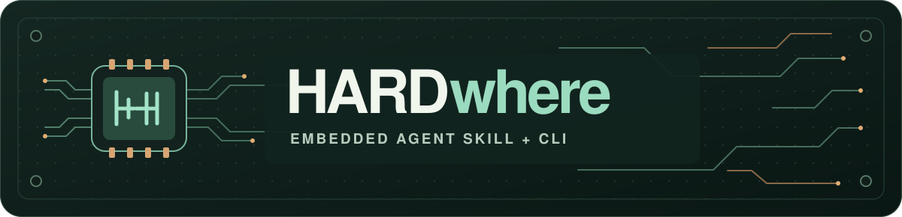

<h1 align="center">
  
</h1>

<p align="center">
  Give your agent the workflow to choose parts, wire a circuit, flash firmware, and verify what runs.
</p>

<p align="center">
  <a href="pyproject.toml"></a>
  <a href="#quickstart"></a>
  <a href="LICENSE"></a>
</p>

<p align="center">
  <a href="#quickstart">Quickstart</a> · <a href="#examples">Examples</a> · <a href="#board-coverage-and-evidence">Board support</a> · <a href="CONTRIBUTING.md">Contribute</a> · <a href="README.th.md">ภาษาไทย</a>
</p>

HARDwhere pairs a shell-enabled agent skill with a Python CLI for embedded work. The skill reads manufacturer documentation, explains design choices, and plans the next bench check. The CLI discovers local devices, calls vendor tools, and gives the agent structured results.

## Quickstart

**Install the CLI.** From the repository, run this in an active Python 3.10+ virtual environment.

```sh
python -m pip install .
hardwhere profiles
```

**Connect your agent.** Copy the entire [skill directory](skills/hardwhere/) into your agent's skill directory. In Codex, use `.agents/skills/hardwhere/` in your project. For an agent that reads instructions from a file, point it to [SKILL.md](skills/hardwhere/SKILL.md). Run the agent in a shell that can find `hardwhere`.

> Use HARDwhere to help me read a BME280 with my ESP32. Confirm my exact board and sensor, cite the pinout, show me the wiring, and verify a temperature reading.

**Plug in hardware when you're ready.** For USB builds, put [Arduino CLI](https://docs.arduino.cc/arduino-cli/installation/) on PATH. For Teensy bootloader discovery, install `python -m pip install ".[teensy]"` and add the [PJRC loader](https://www.pjrc.com/teensy/loader_cli.html) for flashing. For Raspberry Pi, use OpenSSH and a verified host key.

```sh
hardwhere discover --json
hardwhere doctor --board esp32-devkitc-v4 --json
```

## Examples

| Start here | What you'll do |
| :--- | :--- |
| [ESP32 + BME280](examples/esp32-bme280/README.md) | Run a first project from pinout and wiring through build, flash, and a live temperature check. |
| [Raspberry Pi 4B over LAN](examples/pi-lan/README.md) | Set up an SSH alias, run a remote smoke test, and create a private connection skill for future sessions. |

Try the wiring renderer with the ESP32 example on any development machine.

```sh
hardwhere wiring examples/esp32-bme280/wiring.json
```

## From idea to bench


- **Decide from documentation.** Match the board revision, check pin labels and logic levels, and produce a pin table and Mermaid diagram from the same wiring file.
- **Bring up the right target.** Diagnose driver and toolchain issues, install the selected package, and resolve the device again before writing an artifact.
- **Hold on to the evidence.** Check serial or SSH output against the expected behavior and keep the next debug step in a local project checkpoint.

## What you can run

| Workflow | Commands |
| :--- | :--- |
| Inspect USB hardware and tooling | `profiles`, `discover`, `doctor` |
| Prepare dependencies and build firmware | `install`, `build` |
| Upload and verify firmware | `flash`, `monitor`, `verify` |
| Create a wiring guide or resume a session | `wiring`, `context` |
| Set up and use SSH for a Pi | `ssh config`, `ssh probe`, `ssh onboard`, `ssh run` |

See the [CLI reference](docs/cli.md) for invocation, Windows CP210x driver setup, and exit codes.

## Board coverage and evidence

The CLI has four reference profiles. The skill can help research and document other families, including STM32 and RP2040, while the community adds their [board profiles](CONTRIBUTING.md#add-a-board).

| Board | Workflow | Build evidence | Physical bench |
| :--- | :--- | :--- | :--- |
| Arduino UNO R3 | Arduino AVR build, upload, serial | Windows · AVR core 1.8.8 | Awaiting report |
| ESP32-DevKitC V4 · WROOM-32 + CP210x | Arduino ESP32 build, upload, serial. CP210x driver workflow on Windows | Windows · ESP32 core 4.0.0, Adafruit BME280 2.3.0 | Awaiting report |
| Teensy 4.1 | Teensyduino build, HalfKay upload, USB serial | Windows · Teensyduino 1.62.0 | Awaiting report |
| Raspberry Pi 4 Model B · Linux | OpenSSH setup, model probe, Python smoke test | Python syntax checked | Awaiting report |

[GitHub Actions](.github/workflows/checks.yml) defines fixture tests for Windows, macOS, and Linux and compile-only jobs for the three microcontroller examples. See [how to record a bench run](CONTRIBUTING.md#record-a-bench-run) for live results.

## Contribute

Try an example, [report a bench run](.github/ISSUE_TEMPLATE/bench-report.md), or [add a board](CONTRIBUTING.md#add-a-board). A report that includes the exact revision, tool versions, and a short result lets others reproduce the work.

HARDwhere is released under the [MIT License](LICENSE).
