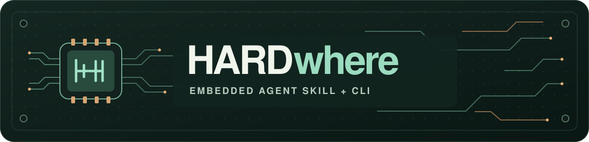

<h1 align="center">
  
</h1>

<p align="center">
  
  <br>
  พัฒนาโดย <a href="https://github.com/Combine1234">@Combine1234</a> ทีม RoboTarn
</p>

<p align="center">
  ให้ agent ช่วยเลือกอุปกรณ์ ต่อวงจร แฟลช และตรวจว่าโปรเจกต์ทำงานอย่างที่ตั้งใจ
</p>

<p align="center">
  <a href="#quickstart">เริ่มใช้</a> · <a href="#examples">ตัวอย่าง</a> · <a href="README.md#board-coverage-and-evidence">บอร์ดที่รองรับ</a> · <a href="docs/references.md">อ้างอิงและ roadmap</a> · <a href="README.md">English</a>
</p>

HARDwhere มีทั้งสกิลและ CLI สำหรับงาน embedded ตัวสกิลช่วยอ่านเอกสารผู้ผลิต อธิบายเหตุผลที่เลือกอุปกรณ์ และวางขั้นตอน debug ส่วน CLI ตรวจอุปกรณ์ เรียกเครื่องมือผู้ผลิต และส่งผลกลับให้ agent ใช้ตรวจต่อ

<a name="quickstart"></a>

## เริ่มใช้

1. เปิด virtual environment ที่ใช้ Python 3.10 ขึ้นไป แล้วรัน `python -m pip install .` จากโฟลเดอร์โปรเจกต์
2. คัดลอกทั้ง [โฟลเดอร์สกิล](skills/hardwhere/) ไปยังโฟลเดอร์สกิลของ agent สำหรับ Codex วางที่ `.agents/skills/hardwhere/` ในโปรเจกต์ หาก agent อ่านคำสั่งจากไฟล์ ให้ชี้ไปที่ [SKILL.md](skills/hardwhere/SKILL.md) และเปิด agent ใน shell ที่เรียก `hardwhere` ได้
3. หากจะ build หรือ flash ผ่าน USB ให้ติดตั้ง [Arduino CLI](https://docs.arduino.cc/arduino-cli/installation/) เพิ่ม สำหรับ Teensy ใช้ `python -m pip install ".[teensy]"` และติดตั้ง [PJRC Loader](https://www.pjrc.com/teensy/loader_cli.html)

```sh
hardwhere profiles
hardwhere discover --json
hardwhere doctor --board esp32-devkitc-v4 --json
```

> ใช้ HARDwhere ช่วยต่อ BME280 กับ ESP32 ของผม เช็กชื่อรุ่นบนบอร์ดกับ datasheet ทำตารางต่อสาย แล้วช่วยทดสอบจนเห็นค่าอุณหภูมิใน serial

<a name="examples"></a>

## ตัวอย่างที่ลองได้

| งาน | สิ่งที่จะได้ลอง |
| :--- | :--- |
| [ESP32 + BME280](examples/esp32-bme280/README.md) | ดู pinout ต่อสาย คอมไพล์ แฟลช และตรวจค่าจากเซนเซอร์ |
| [Raspberry Pi 4B ผ่าน LAN](examples/pi-lan/README.md) | ตั้ง SSH alias ตรวจตัวตนเครื่อง รันโปรแกรมทดสอบ และสร้างสกิลส่วนตัวไว้ใช้ในแชตถัดไป |

ลองสร้างตารางสายและแผนภาพจากข้อมูลตัวอย่างได้ทันที

```sh
hardwhere wiring examples/esp32-bme280/wiring.json
```

## บอร์ดและผลทดสอบ

CLI มีโปรไฟล์เริ่มต้นสำหรับ **Arduino Uno R3, ESP32-DevKitC V4, Teensy 4.1 และ Raspberry Pi 4B** ตัวอย่างเฟิร์มแวร์ของสามบอร์ด USB คอมไพล์ผ่านบน Windows และ Linux แล้ว ส่วนผลแฟลช อ่านเซนเซอร์ และ SSH ยังรอรายงานจากอุปกรณ์จริง [ตารางผลทดสอบ](README.md#board-coverage-and-evidence)

## ร่วมทดสอบกับชุมชน

ถ้าลองกับบอร์ดของคุณแล้ว ช่วยส่งรุ่นบอร์ด ระบบปฏิบัติการ เวอร์ชันเครื่องมือ และผลที่เห็นจริงตาม [แบบฟอร์มรายงาน](.github/ISSUE_TEMPLATE/bench-report.md) สมาชิกที่อยากเพิ่มบอร์ดเริ่มได้จาก [คู่มือร่วมพัฒนา](CONTRIBUTING.md#add-a-board)

โค้ด HARDwhere ใช้ [MIT License](LICENSE) ทีม RoboTarn สงวนสิทธิ์ใน [โลโก้ของทีม](docs/assets/ROBOTARN-NOTICE.md)
